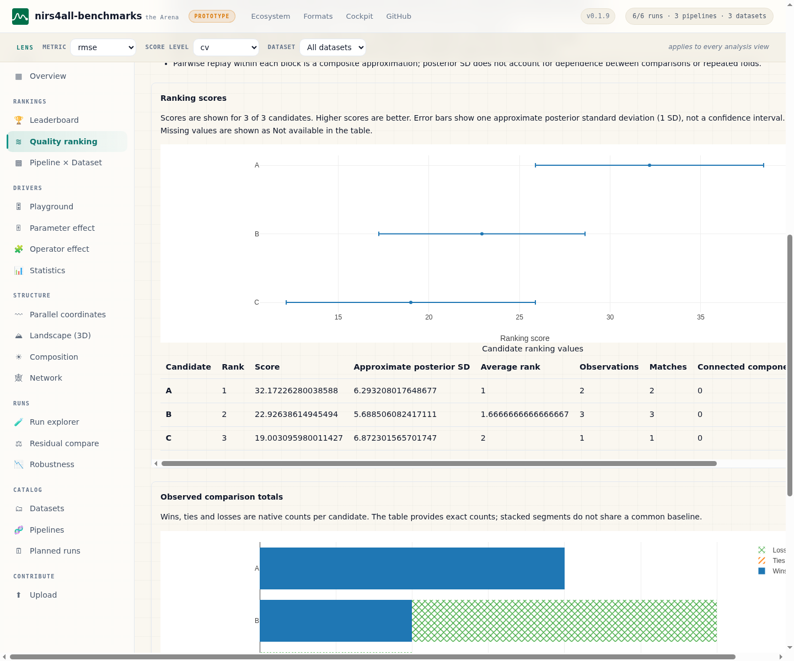
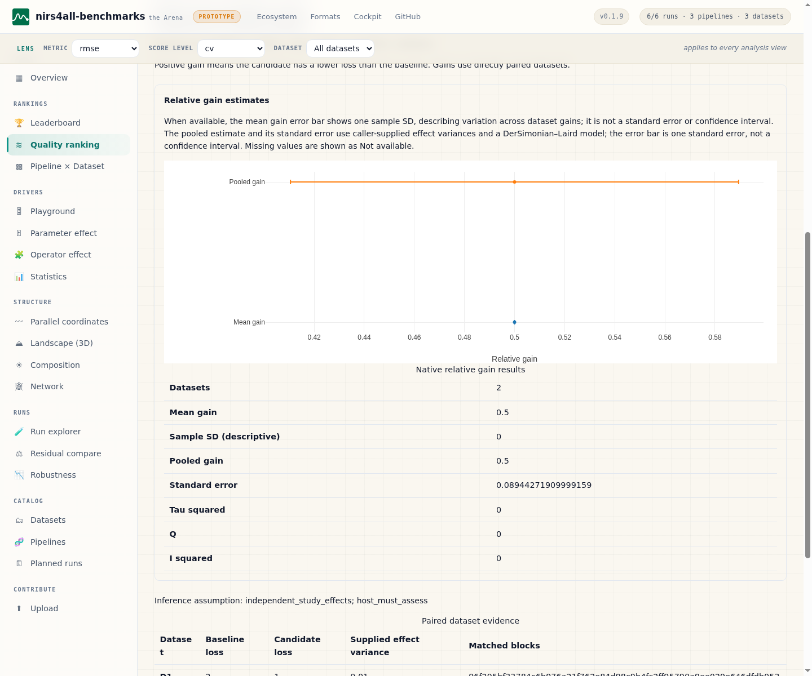

# Quality ranking frontend integration

The Arena keeps its existing JavaScript router. Only the Quality ranking page
mounts a React island using the shared `nirs4all-ui/ranking` exports:
`QualityRankingPanel`, `ComponentRankingView` and `RelativeGainView`.
The dependency and lockfile pin the reviewed immutable UI commit
`39629efdae3664630644e9fdc64c38892d2da618`.

## Reproducible build and distribution

Use Node 24 for build tooling:

```bash
npm ci
npm run test:frontend
npm run build:frontend
```

The build bundles React 19 and the shared ranking components into
`src/nirs4all_benchmarks/web/generated/quality-ranking.js` with esbuild. The
entry point and scoped CSS live under `frontend/`; the generated file and
`node_modules` are ignored and must not be committed. Dependencies remain pinned
in `package-lock.json`. The package license comments remain in the bundle. The build also writes complete
React, React DOM, scheduler and shared UI license/notice texts to
`generated/THIRD_PARTY_NOTICES.txt`, distributed alongside it.

Run the frontend build **before** building Python distributions or static sites:

```bash
npm ci
npm run build:frontend
uv build
```

The wheel's web artifact glob and the sdist's explicit generated-asset glob
include an already-built bundle. A wheel built from that sdist preserves the
bundle, without running npm. Python installation and service startup do not
require Node. An unbuilt source checkout remains usable: opening Quality ranking
shows a local unavailable message while other pages continue to work. Build the
frontend before packaging to include the ranking page. The Pages and PyPI
workflows perform this build; CI also builds and tests the boundary validator.

`site_build` copies the optional `generated` directory with the other web
assets. It does not run npm, copy sibling checkouts or perform scientific work in
the browser.

## Explicit static snapshots

The ordinary static site does not invent ranking evidence or precompute every
filter combination. Request the exact configurations needed by the site owner.
For example, save a `rankings.json` file:

```json
[
  {
    "metric": "rmse",
    "scope": "cv",
    "partition": "validation",
    "dimension": "pipeline",
    "method": "trueskill"
  },
  {
    "metric": "rmse",
    "scope": "cv",
    "partition": "validation",
    "dimension": "parameter",
    "operator": "models.PLS",
    "parameter": "n_components",
    "comparison_mode": "matched",
    "method": "bradley_terry"
  }
]
```

For relative gains, save a separate `gains.json` file. IDs must be candidate
identities emitted by the cohort, not display labels:

```json
[
  {
    "metric": "rmse",
    "scope": "cv",
    "partition": "validation",
    "dimension": "pipeline",
    "baseline_id": "baseline-pipeline-identity",
    "candidate_id": "candidate-pipeline-identity"
  }
]
```

Then build:

```bash
n4a-benchmarks build-site --store ./arena-store --out ./site \
  --ranking-requests ./rankings.json --relative-gain-requests ./gains.json
```

Each file is an array of validated request objects. Invalid JSON, unsupported
fields and a combined count above 64 fail before writing the site. Native
capability and source provenance are checked by the backend; unavailable
analyses are exported with their real reasons. Merely providing a request file
does not supply missing split identities or install a native runtime. See
[the backend contract](QUALITY_RANKING.md) for qualification and evidence rules.

The API index identifies available snapshots. The page lists configurations
matching the shared metric/scope/dataset lens; choose one, then update the result.
Method, dimension, partition, direction, cohort filters, operator-qualified
parameter, comparison mode, tolerance and options must match. A different
selection displays unavailable rather than showing a nearby cached result.
Known metric directions resolve on the server and in the static transport;
custom metrics require an explicit direction supplied by the user.

## Controls and interpretation

All eight dimensions are available: pipelines, models, preprocessing sequences,
preprocessing operators, feature selection, augmentation, parameter values and
split strategies. Parameters require both the full operator name and parameter
name. Matched preprocessing-operator comparisons also require a selected
operator, comparing its presence with its absence while holding the remainder
of a strict linear pipeline fixed. These comparisons remain descriptive.

The partition is explicit. Split strategies request `external_error` and require
a test/final partition and test/refit score level; the shared lens controls the
score level. Task, collection and scoring protocol filters, tie tolerance and
numeric method options are available in the additional settings disclosure.

Load a ranking, then select Paired relative gain to choose baseline/candidate
identities from the eligible cohort. It uses the separate native-backed endpoint
and only direct paired positive-loss evidence. Leave effect variances empty for
descriptive mean gain and sample SD. Supply a complete dataset-keyed variance
object only when paired-effect sampling variances, covariance and independence
are justified. The browser does not estimate variances, ratios, ratings or
meta-analysis statistics. The shared component distinguishes sample SD from the
standard error of a supplied-variance pooled estimate.

## Boundary, accessibility and lifecycle

The host validates schema versions, candidate values, provenance, nested result
objects and request identity before passing artifacts into shared typed views.
Equivalent option-key ordering is accepted; mismatched requests, nonfinite
values and unsupported schemas produce a local error. React also has a local
error boundary. The optional bundle is dynamically imported inside the route,
so a missing file cannot prevent ordinary Arena startup.

The host Plot renderer forwards the shared component's Plotly data/layout/config,
adds responsive sizing and purges charts on unmount. The router aborts obsolete
routes, and the island ignores responses from obsolete requests. Charts grow
with the complete candidate list inside a contained scroll region; candidates
are never silently truncated. The shared summary and HTML tables remain visible
when Plotly is unavailable. Native controls and status announcements expose
filter changes without relying on color or chart interaction.

Real Chrome tests in `tests/test_quality_ranking_ui.py` exercise the actual built
React package and Plotly. Native fixtures cover A/B on D1 plus B/C on D2 with no
complete block, disconnected groups, missing native runtime, corrupt/unsupported
artifacts, a missing bundle, exact static cache misses, qualified component
selectors, dataset lens changes, chart cleanup, delayed responses during
navigation, and descriptive/supplied-variance relative gains. They skip explicitly
when the built bundle, native ranking capability or Chrome is absent.

## Review screenshots

These previews use synthetic A/B/C candidates and controlled D1/D2/D3 datasets
from the browser test fixture, not private or measured scientific datasets.
They show actual libn4m results rendered by the pinned shared React components
and Plotly. Captured on 2026-11-04 with Chrome DevTools after chart painting.
The tables provide the same values and explain the different uncertainty types.





## Adjusted effects and surrogate importance

The Analysis selector also mounts `ComponentAnalysisApp`, which offers native
Gaussian mixed effects and random-forest fANOVA through `/api/component-analysis`.
The controls declare a simple design preset, explicit categorical references or
numeric/category domains, an optional qualified model slice, scale-free or native
paired-baseline outcomes, and disjoint training/held-out dataset identities.
Original-observation previews precede fitting; missing conditional parameters
are never converted into numeric defaults. Static users can select an exact
precomputed request, including its full domain and estimator configuration.

`validateComponentAnalysis` checks the entire normalized nested request before
rendering, validates coefficient and covariance dimensions and native fANOVA
factor indices, and rejects nonfinite data. Changing controls clears previous
results and invalidates pending responses. Navigating away unmounts the analysis
and purges its Plotly figures.

Shared `MixedEffectsView` and `FanovaView` display supplied numerical values only.
Coefficient error bars show one conditional plug-in SE; importance tree SD is
descriptive tree dispersion. Neither is presented as a confidence interval.
Exact native values, reference levels, domain assumptions, original source
counts, fit/refusal diagnostics and held-out prediction diagnostics remain in
visible HTML tables or details. `tests/test_component_analysis_ui.py` exercises
both real native artifacts in Chrome, changed-response identity rejection,
absence of stale tables and cleanup of delayed requests during navigation.
